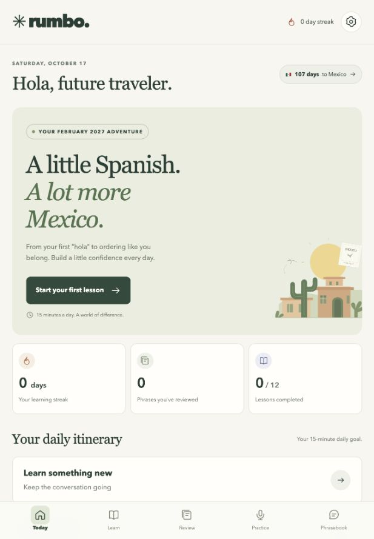

# Rumbo

**A little Spanish. A lot more Mexico.**

Rumbo is a small, mobile-first Spanish learning app built for a real trip to Mexico in February 2027. It turns a beginner grammar guide into short lessons, Mexican Spanish listening, speaking practice, spaced review, and the conversations you might have over tacos, in a taxi, or at a hotel.

The name comes from the Spanish word *rumbo*: direction, course, or heading. *Rumbo a México* means heading to Mexico.

## Why we made it

The starting point was a useful Word document and a practical question: how do you turn reading about Spanish into feeling ready to use it in Mexico?

A document can explain a verb or give you a phrase. Before a trip, you also need to hear it, say it, remember it a few days later, and recognize when to use it. Rumbo puts those activities together in a small daily routine.

It was designed around one learner and one departure date, but the situation is familiar: a trip is coming, you have good study material, and you want a manageable way to practice. The app is here for other travelers and beginners who want to adapt that approach to their own plans.

The aim is everyday confidence: asking someone to repeat, introducing yourself, ordering food, finding your way, and keeping a small conversation going. Progress is an account of your practice, not a promise of fluency.

## Thank you, Trinia

**Trinia shared the initial document, _Gramática básica del español_, that gave this project its starting material and direction. Thank you, Trinia, for sharing it and helping make this learning journey possible.**

The core lessons adapt the topics in that guide: basic questions, introductions, present-tense verbs, activities and preferences, places and weather, articles, and demonstratives. Travel dialogues, extra phrases, pronunciation tips, and the practice tools extend that foundation.

The repository contains the adapted app curriculum; the original Word document is not included.



## What you can practice

| Area | What is included |
| --- | --- |
| Learn | 12 short lessons with examples and 48 multiple-choice questions |
| Listen | Device text to speech that prefers Spanish Mexico (`es-MX`), plus slower playback |
| Speak | Browser speech recognition, transcript comparison, typed recall, and record and replay |
| Remember | 90 phrases with recall ratings and scheduled review intervals |
| Travel | Six guided role plays: restaurant, taxi, hotel, market, directions, and meeting someone |
| Track | Completed lessons, reviewed phrases, practice points, streaks, and a trip countdown |
| Take it with you | Responsive phone layout, web app manifest, and an offline app shell |
| Keep your progress | Browser-local storage and JSON backup import and export |

The suggested routine is a short lesson, a ten-card review, and a little listening and speaking. The daily goal and departure date can be changed in Settings. The initial departure date is February 1, 2027, as a placeholder for the exact trip date.

## How we made it

Rumbo grew out of a conversation with Codex, starting with a beginner grammar document and the need to hear and practice Spanish for Mexico.

1. **Read the source material.** We extracted the text from the Word document and used its grammar topics as the course outline. We kept the explanations in English and the examples in Spanish.
2. **Turned topics into practice.** A GPT-6 Astra specialist agent helped prepare the structured curriculum: lessons, questions, flashcards, pronunciation notes, and travel conversations. The main Codex agent built the application and connected those activities to progress and review scheduling.
3. **Adapted the language to the destination.** Examples focus on Mexican usage, including tú, usted, and ustedes. Overgeneralized statements in the source were made more precise, including articles after hay and regional pronoun usage.
4. **Used the browser’s existing tools.** The app uses native speech APIs, local storage, a service worker, and a web app manifest. There is no framework, build step, backend, or application API key to configure.
5. **Made the daily experience small and readable.** The interface combines a short daily itinerary with a searchable phrasebook, guided practice, and a calm mobile layout. The street illustration and icons are code-based SVGs.
6. **Checked real behavior.** Automated checks cover scheduling, dates, backup validation, word comparison, and curriculum structure. Browser checks covered lesson completion, review controls, typed practice, a restaurant conversation, and phrasebook search. Layouts were inspected at 390 and 1280 pixels. The original learner also confirmed that the app opened successfully on an iPhone over home Wi-Fi.

AI helped author both the software and the learning activities. The curriculum remains editable, and corrections to the Spanish, translations, or explanations are welcome.

## Run locally

You need **Node.js 20 or newer**. There are no packages to install.

```sh
git clone https://github.com/sudockin/rumbo.git
cd rumbo
npm start
```

Open **http://127.0.0.1:5173**. Keep the terminal open while using the local app; press Control C to stop the server.

If you have Python 3 instead of Node, run this from the repository folder:

```sh
python3 -m http.server 5173 --bind 127.0.0.1 --directory dist
```

Serve the app over HTTP or HTTPS rather than opening `index.html` directly. JavaScript modules and the offline shell need a server.

## Study on an iPhone

For use away from your computer, serve the contents of `dist/` with an HTTPS static host. Uploading this repository to GitHub does not by itself publish a live website. Relative asset paths and hash-based navigation let the app work from an origin root or a repository subdirectory.

Open the hosted address in Safari, then use **Share → Add to Home Screen**. Keep Open as Web App enabled if that option is offered. Exact controls vary with the iOS version.

For a temporary home Wi-Fi setup, connect the Mac and iPhone to the same network, then run this on the Mac from the repository folder:

```sh
python3 -m http.server 5173 --bind 0.0.0.0 --directory dist
```

On the iPhone, open Safari and enter `http://YOUR-MAC-IP:5173`, replacing the placeholder with the Mac’s Wi-Fi IP address. Keep the Mac awake and the server running. This shares the app’s static files with devices that can reach the Mac on that network. HTTPS hosting is needed for the full microphone and offline experience on a phone.

Progress is stored per browser and origin. A local copy, a home Wi-Fi address, and a hosted copy each have their own progress. Use Settings to export and import a backup when moving between them.

## Mexican Spanish audio and speech

### Listening

Rumbo automatically prefers an available `es-MX` voice. If your browser does not expose one, add a Spanish Mexico voice through your device’s accessibility or text-to-speech settings, then reopen the app. You can deliberately choose another Spanish voice; the app displays its language.

Listen uses the chosen speed. Slower uses 0.65× playback. The speech is synthetic and provided by the device or browser. Offline listening depends on having a locally available voice.

### Speaking

Speech recognition requests `es-MX` where supported. The word-match result compares the recognized transcript with the model sentence. **It is not an accent or pronunciation score.** Browser recognition may require internet and send audio to the browser provider.

Record and replay captures up to 15 seconds for listening back. Those recordings stay in memory, are not uploaded by the app, and are cleared when leaving the practice view. Typed practice and self-reported speaking are available too.

Microphone access requires HTTPS or localhost and browser permission. Live capture, playback, and recognition still need checking on each target device; browser support varies.

## Review and data

The review scheduler introduces up to ten due or new cards per session. Again becomes due after one minute. A first Hard or Got it rating schedules a card for one day later; Easy schedules it for three days later. Later intervals grow with the recall ratings. This is a lightweight spaced-review implementation, not a measured mastery model.

The app has no user accounts or sync service. Lessons, settings, review dates, and activity are saved in browser local storage. Export a backup before clearing browser data. Import requires confirmation before replacing the current device’s progress.

Estimated minutes come from completed activities. Points and streaks indicate practice, rather than proficiency.

After a successful first online load, the service worker caches the app shell, lessons, and phrasebook for offline text activities. Audio, recognition, installation, and any host sign-in have their own browser or network requirements.

## Adapt it for your own trip

Change the departure date and daily goal in Settings. Edit `dist/content.mjs` to change the lessons, phrases, role plays, and study phases. Keep stable item IDs if you want existing progress to stay associated with the same content. Changes to the destination branding also belong in the app text, index page, and web app manifest.

The current course is a beginner companion focused on Mexico. It does not generate open-ended AI conversations or provide live human pronunciation feedback.

## Project structure

```text
dist/
  app.mjs                 Views, controls, and browser speech integration
  content.mjs             Lessons, quizzes, phrases, and travel conversations
  core.mjs                Review scheduling, dates, backup validation, word matching
  index.html              App shell
  styles.css              Responsive layout and visual design
  sw.js                   Offline caching
  manifest.webmanifest    Installable web app metadata
scripts/
  serve.mjs               Local static server with no dependencies
tests/
  core.test.mjs           Seven behavior and curriculum checks
docs/images/
  rumbo.png               App preview
```

## Checks and contributions

```sh
npm test
npm run check
```

The current seven automated checks pass. Browser microphone behavior is a device-level check, separate from the automated suite.

Useful contributions include better beginner explanations, natural Mexican Spanish alternatives, accessibility improvements, browser compatibility fixes, and clearer travel dialogues. Describe what you changed, why it helps a learner, and how you checked it. Please do not commit personal progress exports, credentials, or private learning documents.

## Credits

- **Trinia** — shared the initial grammar document that sparked the project.
- **The original learner** — supplied the goal, learning material, Mexico trip context, and iPhone feedback.
- **Codex, with a GPT-6 Astra specialist agent** — helped turn the brief into the curriculum, interface, and working application.

Thank you to everyone who shares learning material, tries a small conversation, or contributes a correction.
